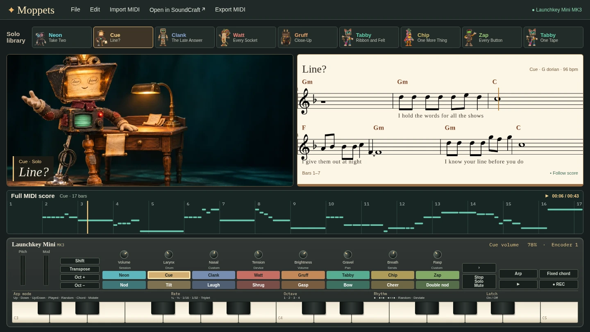
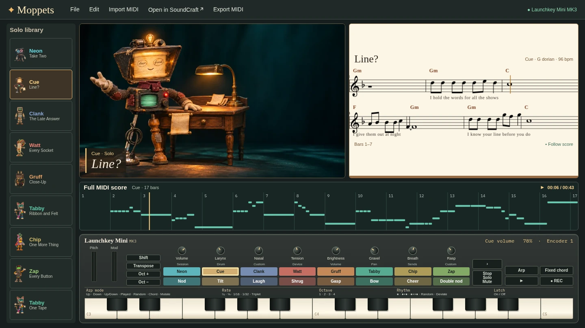
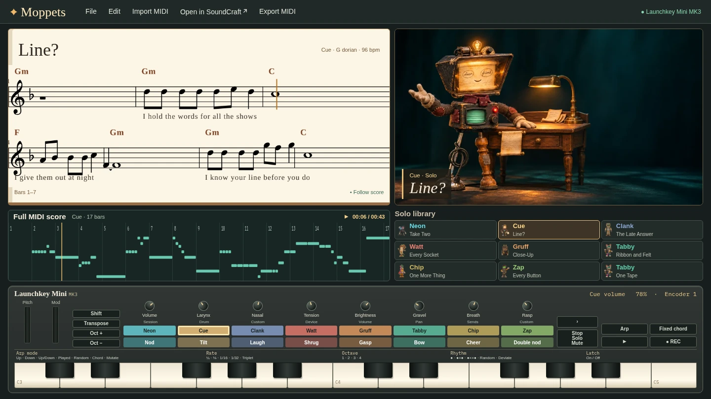

# Cue’s performance desk

Three design studies for **Line?** at 1440 × 810. Open `index.html` with the fragment `#A`, `#B` or `#C`, or compare the images below. The screens show a single playing moment. The cast tiles represent nine solo songs; the hardware pads address eight performers.

### A · Stage and music rack

The solo tiles run across the top. The video and lead sheet share the main row. All 17 bars of MIDI sit directly beneath them, above the Launchkey.

### B · Cast library

A permanent left rail pairs every performer portrait with a song title. The right-hand workspace keeps the stage, score, MIDI and keyboard together while browsing the cast.

### C · Score desk

The sheet and piano roll share the left column; Cue performs above a compact solo wall on the right. Both hands can stay on the controller while comparing notation to MIDI.

The stage image is a visual proposal made from Cue’s existing puppet portrait. The notation and piano roll use the current G-dorian score. Chord symbols sit on the staff at the measure or beat where they change. The selected character volume, gesture pads and cast pad assignments are app mappings. Hardware positions and the Shift, Arp and Fixed Chord legends follow the [Novation Launchkey Mini MK3 user guide, pages 8 and 20–26](https://fael-downloads-prod.focusrite.com/customer/prod/s3fs-public/downloads/Launchkey%20Mini%20MK3%20User%20Guide%201.1%20English%20EN.pdf).
