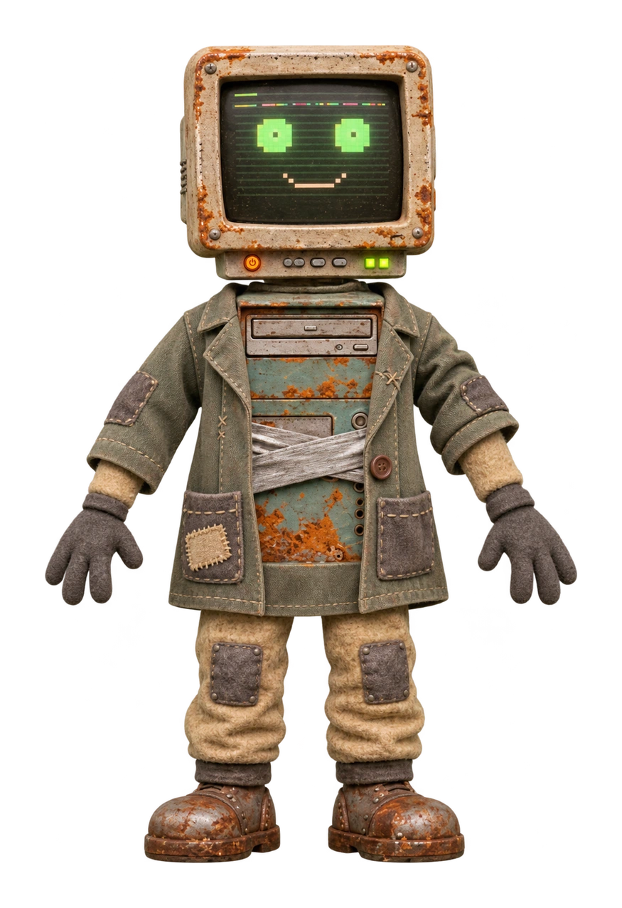

# Clank · Tenor

Old PC monitor head and rusty tower body, worn tape and jointed sleeves. Keep the face inside the CRT bezel.

## Acting

CRT face · One jointed sleeve

Hold the screen blank through the missed entrance. The face catches up, then one sleeve rises sheepishly as the answer lands.

1. Wait one beat
2. Start the answer late
3. Hold the lit screen for the reply

## Model reference

Tabby stands 100 drawing units tall. Clank is staged at 116 DU tall, with a projected front span of about 75.6 DU in this pose. Depth is estimated from supporting views.

Keep every tail, limb, ear, plug lead and moving costume part attached at its own socket for the full take, including when held or briefly hidden. Hands can guide an attached tail. Any removal is a separately named comedy gag with its own explicit performance brief.

## Earlier rehearsal sources

Sprite source: /run/media/jesse/Speedy/magic-studio-assets/storyboards/moppet-choir/neon-playbook/flow-outputs/clank__sprite_grid_01.png

Turnaround source: /run/media/jesse/Speedy/magic-studio-assets/storyboards/moppet-choir/neon-playbook/flow-outputs/clank__turnaround_01.png

## Rehearsal exposures

[32 source exposures](exposures.webp) · [Source frames](exposures.json)
