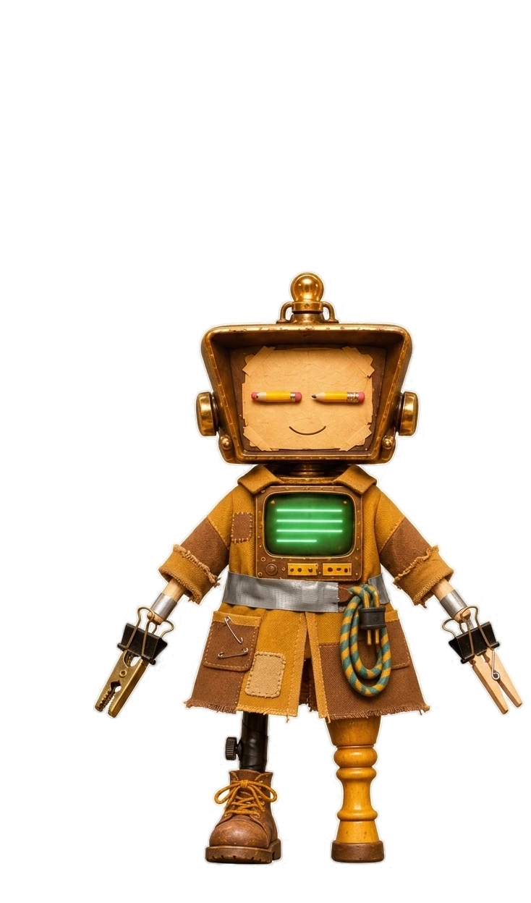

# Cue · Prompt captain

Brass teleprompter hood, cream paper face, two physical pencil brows, green chest CRT, one leather boot and one wooden peg. Follow a single braided cord from hand to plug.

## Story

Cue held the lines under the studio camera. At load-out the camera went in its case, but the prompter hood was too wide to fit and stayed on its stand. Cue took the STAND BY card literally and still waits beside the mark. He wants everyone to have a line. Clank lent him the braided cable he lays out as a loop. One script stays tucked away, with its last page blank.

In **Right on Cue**, he casts his cable to give Neon a mark, then bows two beats too early. Watch the pencil brow catch the mistake before the hand gives the next entrance.

## Acting

Pencil brows · Cueing hand

One pencil cocks over the line he forgot. Let the audience read it; then the open hand gives the next singer a precise entrance.

1. Gather the cord
2. Cast with one open palm
3. Leave the loop for the next singer

## Model reference

Tabby stands 100 drawing units tall. Cue is staged at 97 DU tall, with a projected front span of about 59.9 DU in this pose. Depth is estimated from supporting views.

Keep every tail, limb, ear, plug lead and moving costume part attached at its own socket for the full take, including when held or briefly hidden. Hands can guide an attached tail. Any removal is a separately named comedy gag with its own explicit performance brief.

Use the acting sheet for body blocking. Its release pose doubles the cord.

## Earlier rehearsal sources

Sprite source: out/cue-locked/bench/cue-cast-poses.jpg

Turnaround source: out/cue-locked/bench/cue-turnaround.jpg

## Six-deliverable Flow pack

The updated turnaround and acting sheet come from the all-selected Cue run. Read the [eight expressions](expressions.webp), [stage and loose props](stage-props.webp), [isolated parts reference](parts.webp) and [15-pin manifest](rig.json) together. Isolated parts are from the approved cutout library after the Flow item failed. The clean stage is an alternate rehearsal set. The original duet uses its locked stage.

## Rehearsal exposures

[32 source exposures](exposures.webp) · [Source frames](exposures.json)
