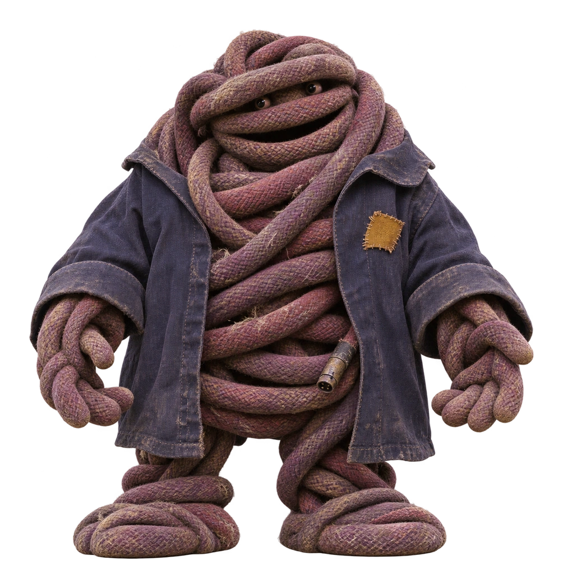

# Gruff · Bass

A giant tangle of old broadcast multicore cable in an indigo stage coat. His mouth is the gap between two coils. Huge loop hands play a road-case upright bass; one attached lead connects him to the band.

## Acting

Coil mouth · One enormous loop hand

A gentle gap opens between two coils for a low line. One huge hand answers on the bass; his weight stays planted.

1. Lean the boom pole to set the pitch
2. Pull the bass string with one giant hand
3. Hold still and listen for the return

## Model reference

Tabby stands 100 drawing units tall. Gruff is staged at 200 DU tall, with a projected front span of about 190.7 DU in this pose. Depth is estimated from supporting views.

Keep every tail, limb, ear, plug lead and moving costume part attached at its own socket for the full take, including when held or briefly hidden. Hands can guide an attached tail. Any removal is a separately named comedy gag with its own explicit performance brief.

New giant cable design. Earlier solo pictures show the retired combined amp/cable design.

## Earlier rehearsal sources

Sprite source: /run/media/jesse/Speedy/magic-studio-assets/storyboards/moppet-choir/neon-playbook/flow-outputs/gruff__sprite_grid_01.png

Turnaround source: /run/media/jesse/Speedy/magic-studio-assets/storyboards/moppet-choir/neon-playbook/flow-outputs/gruff__turnaround_01.png

## Rehearsal exposures

[32 source exposures](exposures.webp) · [Source frames](exposures.json)
