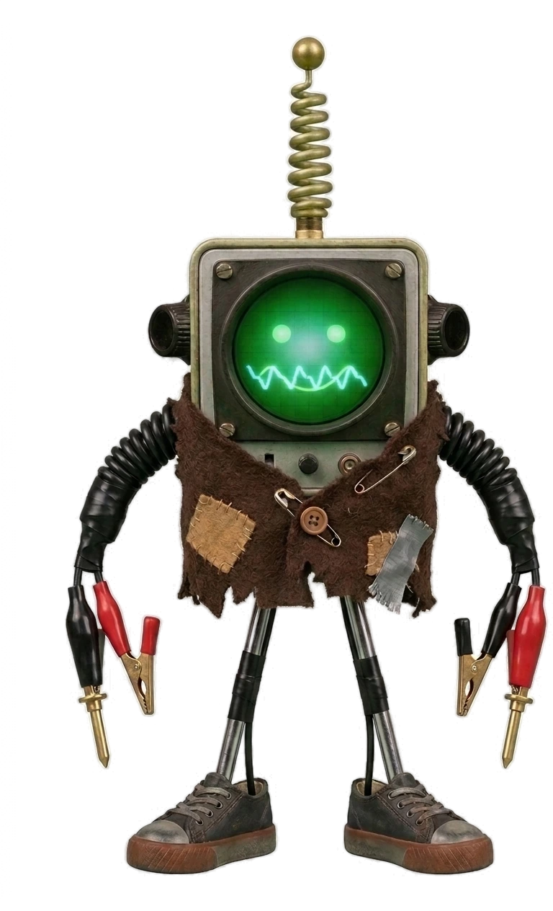

# Hertz · Screen coach

Wood-panel CRT, aerial and phosphor screen. Keep the picture on the glass and the feet on the AV cart.

## Story

Hertz was the edit cart’s monitor. The crew left the deep CRT strapped to the school cart because the strap was the only way to move it safely. Hertz takes the old school name on the strap as his teaching assignment. Tracking lends him a short coax offcut that braces his aerial. He wants everyone to see the gesture as clearly as he does. An unrecognised face still shows faintly when his screen goes dark.

In **study hall**, Hertz holds the picture for the cast, then tips his aerial toward Tracking. They always dance together and never agree which bit was best.

## Acting

Phosphor picture · Aerial

Hold the reply on the glass long enough to read. Afterward the aerial leans toward Tracking for an answer.

1. Face Tracking
2. Hold the picture on the glass
3. Tip the aerial toward the cast

### The Good Bit

Hertz starts out sure the jump is the part worth keeping. Hold the bright picture on the glass for Tracking to spot the smaller heel-and-toe step. Let the aerial settle into the freeze, then answer Tracking's count with the same step. Keep both ends of their one AV lead attached through the duet.

## Model reference

Tabby stands 100 drawing units tall. Hertz is staged at 108 DU tall, with a projected front span of about 74.3 DU in this pose. Depth is estimated from supporting views.

Keep every tail, limb, ear, plug lead and moving costume part attached at its own socket for the full take, including when held or briefly hidden. Hands can guide an attached tail. Any removal is a separately named comedy gag with its own explicit performance brief.

## Earlier rehearsal sources

Sprite source: /run/media/jesse/Speedy/magic-studio-assets/storyboards/moppet-choir/neon-playbook/flow-outputs/hertz__sprite_grid_01.png

Turnaround source: /run/media/jesse/Speedy/magic-studio-assets/storyboards/moppet-choir/neon-playbook/flow-outputs/hertz__turnaround_01.png

## Rehearsal exposures

[32 source exposures](exposures.webp) · [Source frames](exposures.json)
