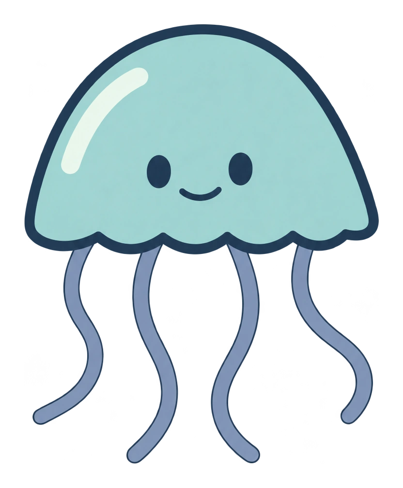

# Moonbeam · Guest soloist · Borrowed Light

Ink-drawn moon jellyfish with a teal bell, navy outline and four trailing tentacles.

## Acting

Bell face · One leading tentacle · Bell glow

The face lands the lyric. One tip follows the wandering spot while the other three trail. Save the glow for her answer to the blackout.

1. Follow the stage light left, then right
2. Spring above the lamp and land on the boards
3. Answer the dark with a glow

## Model reference

Tabby stands 100 drawing units tall. Moonbeam is staged at 70 DU tall, with a projected front span of about 56.6 DU in this pose. Depth is estimated from supporting views.

Keep every tail, limb, ear, plug lead and moving costume part attached at its own socket for the full take, including when held or briefly hidden. Hands can guide an attached tail. Any removal is a separately named comedy gag with its own explicit performance brief.

Moonbell is the Flow asset name. Her workshop solo uses the Vee scratch voice.
