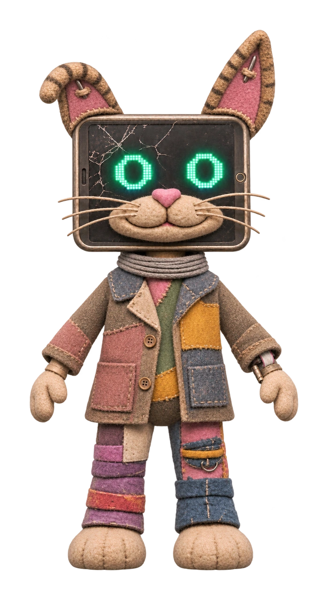

# Tabby · Soprano

A discarded pen tablet dressed as a cat. Cracked glass with aqua ring eyes, a fixed muzzle, patched clothes, and striped felt ears tucked behind the bezel on hidden front/back and side-to-side pivots. A short exposed wire under a stitch shows how she attached each ear.

## Story

Tabby was the pen tablet used to draw turnarounds. The crew set her aside after the glass cracked and packed the working tablet. Tabby treats the crack like a line she has to hit for her bow. Chip lent her the flat ribbon link under her cuff. She learned her steps and bows from one clipped rehearsal video stuck on her screen and wants the room to hear her own voice.

In **One Tape**, her eyes find the sound before an ear tries to follow. Give the occasional word in somebody else’s voice room to land.

## Acting

Aqua ring eyes · Loose antenna ears · Whisker tips

Her eyes find the sound. One ear tries to point like a cat, overshoots sideways, then flops forward into place. Save a single whisker twitch for a surprised silence.

1. Find the sound with the ring eyes
2. Tip one ear and let the loose felt settle
3. Bow with both feet planted

## Model reference

Tabby stands 100 drawing units tall. Tabby is staged at 100 DU tall, with a projected front span of about 49.8 DU in this pose. Depth is estimated from supporting views.

Keep every tail, limb, ear, plug lead and moving costume part attached at its own socket for the full take, including when held or briefly hidden. Hands can guide an attached tail. Any removal is a separately named comedy gag with its own explicit performance brief.

The front reference supersedes the ear construction on the earlier rehearsal sheets.

## Earlier rehearsal sources

Sprite source: /run/media/jesse/Speedy/magic-studio-assets/storyboards/moppet-choir/neon-playbook/flow-outputs/tabby__sprite_grid_01.png

Turnaround source: /run/media/jesse/Speedy/magic-studio-assets/storyboards/moppet-choir/neon-playbook/flow-outputs/tabby__turnaround_01.png

## Rehearsal exposures

[32 source exposures](exposures.webp) · [Source frames](exposures.json)
