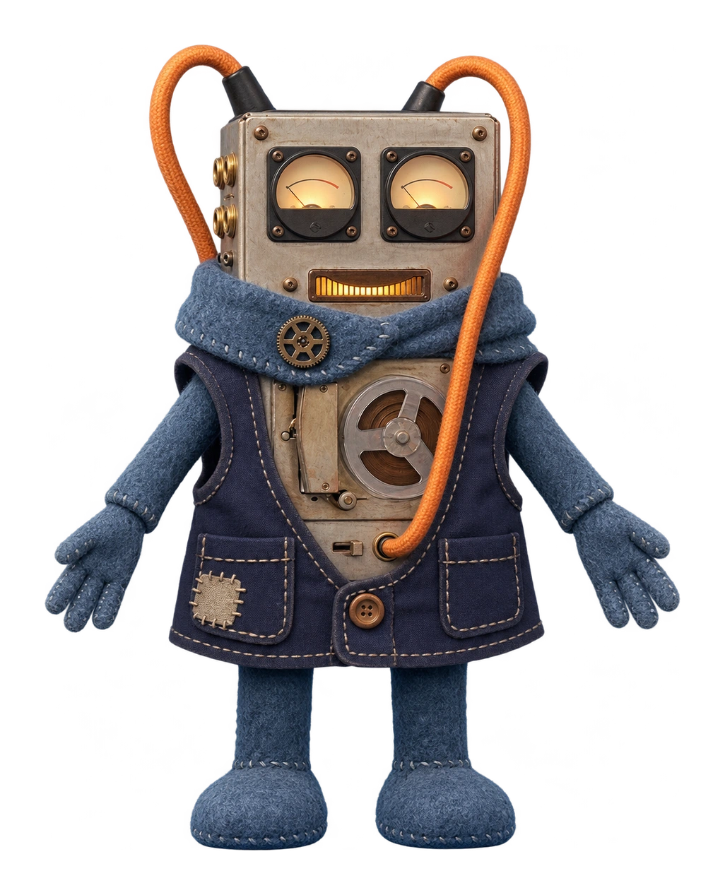

# Thrum · House band · patch and echo

Steel broadcast patch-bay chassis, two warm VU meters, blue felt scarf and an orange cable bass string. Preserve the front panel and the cable loop.

## Acting

Patch hand · Paired VU needles

One hand opens the return for a short echo; the VU needles show its decay.

1. Open the return
2. Catch the chord on the tape loop
3. Close the return before the next lyric

## Model reference

Tabby stands 100 drawing units tall. Thrum is staged at 106 DU tall, with a projected front span of about 83.6 DU in this pose. Depth is estimated from supporting views.

Keep every tail, limb, ear, plug lead and moving costume part attached at its own socket for the full take, including when held or briefly hidden. Hands can guide an attached tail. Any removal is a separately named comedy gag with its own explicit performance brief.

Thrum plays the echo returns in the house band. The earlier Moonbeam rehearsal features a cable-bass cameo.

## Earlier rehearsal sources

Sprite source: /run/media/jesse/Speedy/magic-studio-assets/storyboards/moppet-choir/neon-playbook/assets/cast/thrum-pair.png

Turnaround source: ImageGen turnaround study from approved rest portrait

## Rehearsal exposures

[13 source exposures](exposures.webp) · [Source frames](exposures.json)

## One Quiet Bar

Thrum worked the patch bay in a booth with a broken call button. The operator sent short signals down the return cable instead. The racks went out first; the return module stayed bolted under the booth desk. Thrum kept one coil from that line and learned to tell a real reply from an echo by watching the two needles.

In **the long return**, the return stays open while Thrum sings three increasingly low “on” notes at beats 78, 80 and 82. Let the pluck action mark each repeat and allow a longer settle after the last one. At beat 84, release the cable to its rest position as Amplifier asks Thrum to close the return.
