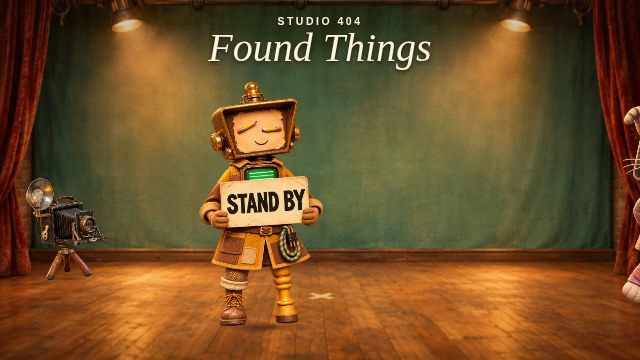
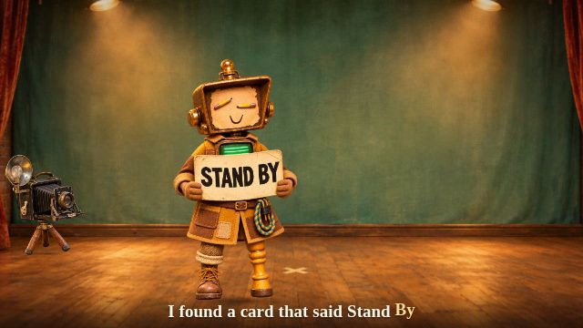
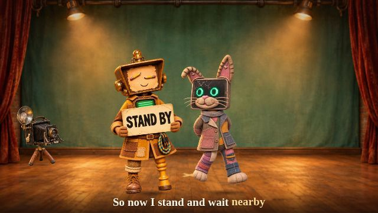
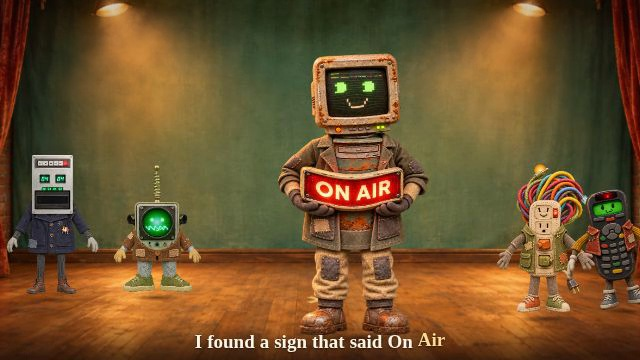
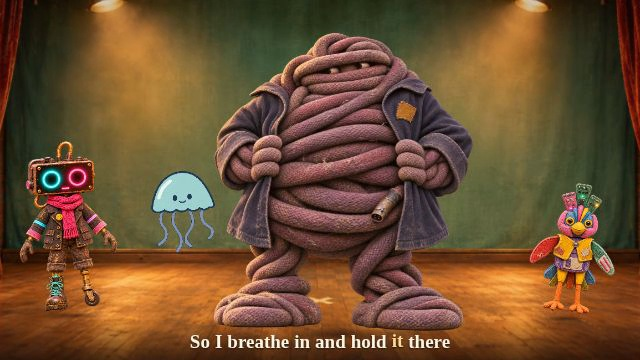
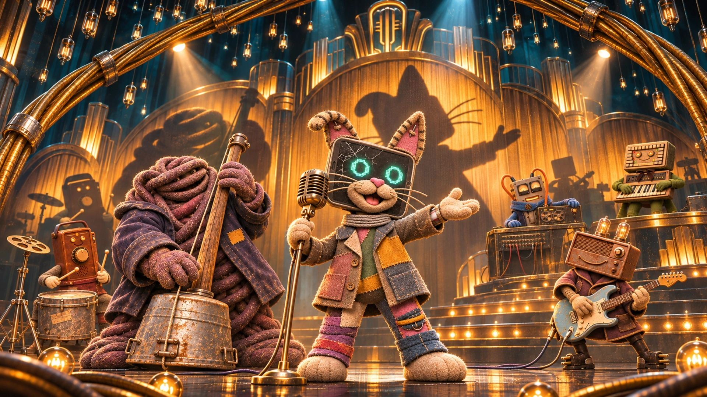
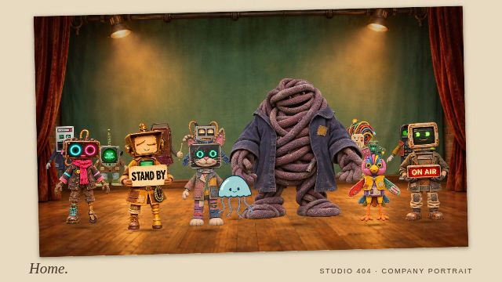

# Found Things

A camera tries to get the company into one picture. On the chorus we see the huge show they imagine; the shutter brings them home.

## 01 · 0:00–0:03 · The picture nobody has taken

A little camera waits on a tripod. Cue finds a discarded card.

## 02 · 0:03–0:08 · Stand by

Cue holds the card up. Give the pencil brow one beat to read it.

## 03 · 0:08–0:13 · Right beside it

Tabby walks up and stands beside the card. Her ear tips toward Cue.

## 04 · 0:13–0:18 · On air

Clank finds the lamp. Watt supplies the click and Zap cues the room.

## 05 · 0:18–0:23 · Hold it there

Gruff inflates. Chip leans away. Moonbeam rises on the escaping breath.

## 06 · 0:23–0:28 · The stage in their heads

The tiny band hears a full theatre. Gold cables become arches; the chorus opens wide.

## 07 · 0:28–0:31 · Home

One shutter click returns us to their little stage. All fifteen fit in the photograph.

